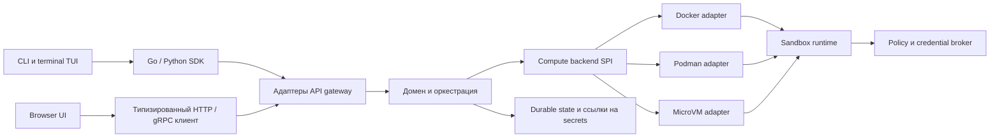

<!--
SPDX-FileCopyrightText: Copyright (c) 2026 cautem
SPDX-License-Identifier: Apache-2.0
-->

# Архитектура и границы модулей

Принятое решение, задающее эти контракты, записано в
[ADR 0001: доменная модель и compute backend SPI](decisions/0001-domain-and-backend-spi.md).

Quarshell — название продукта в целевой архитектуре. Опубликованные пути
модулей и команд пока остаются в пространстве имён Cautem; этапы перехода
описаны в [плане переименования и релиза](../reference/renaming-and-release.md).



## Ответственность модулей и зависимости

| Модуль | Ответственность | Допустимые зависимости |
|---|---|---|
| `quarshell-core` | Доменные значения, policy, валидация, типизированные ошибки, capability model | Стандартная библиотека и небольшие domain utilities |
| `quarshell-proto` | Схемы Quarshell control API и generated client types | Инструменты генерации схем |
| `quarshell-driver` | Compute SPI и реализации Docker, Podman, MicroVM | Core, контракты runtime assets, клиенты engine |
| `quarshell-runtime` | Guest init, supervisor, SSH/PTY, guest protocol | Core и runtime assets |
| `quarshell-proxy` | Egress enforcement, credential mediation, audit | Core policy и runtime protocol |
| `quarshell-providers` | Provider profiles, credential declarations, refresh validation | Core policy |
| `quarshell-gateway` | Сборка API, auth, durable state, оркестрация операций | Core, proto, driver, runtime, proxy, providers |
| `quarshell-sdk` и `quarshell-python` | Типизированные API clients и streaming helpers | Публичные API schemas |
| `quarshell-cli` | Команды, terminal presentation, shell completions | SDK и terminal libraries |
| `quarshell-ui` | Browser presentation и browser-safe client | Typed browser client и gateway API |
| `quarshell-display`, `quarshell-slogx`, `quarshell-docs` | Display, logging utility, документация | Узкие публичные интерфейсы |

Зависимости идут в одну сторону: API clients вызывают gateway; gateway выбирает
и проверяет backend; backend использует runtime и host engine. Gateway не
импортирует CLI или UI. Terminal TUI может оставаться presentation package
внутри CLI и использовать SDK. Browser UI использует типизированный API client,
не запускает CLI и не импортирует его internal packages.

Такое разделение следует публичным интеграционным поверхностям современных
инструментов. В OpenShell v0.1.4 отдельно выделены CLI, SDK, server и compute
driver crates. Cursor документирует Agent в редакторе и CLI с интерактивным и
неинтерактивным режимами; CLI поддерживает режимы редактора, но документация
не утверждает, что клиенты используют общий внутренний API. OpenAI публикует
интеграции Codex CLI, SDK и app-server: SDK предназначен для программных задач,
а app-server открывает приложению потоки threads, turns, events и approvals,
оставляя интерфейс и workflow за host-приложением. Эти данные подтверждают
выбранный принцип: CLI и browser UI Quarshell являются отдельными клиентами
общего публичного API. Источники не раскрывают внутреннее устройство Cursor и
Codex. См. [обзор Cursor Agent](https://cursor.com/docs/agent/overview),
[обзор Cursor CLI](https://cursor.com/docs/cli/overview) и
[интеграцию Codex app-server](https://developers.openai.com/blog/codex-as-a-platform).

В текущий Cautem release пока входит старый Go server `cautem-console` из
репозитория CLI. Это отдельный SDK client, который не импортирует пакеты команд
CLI. Он не является целевой browser app: TypeScript PWA находится в отдельном
модуле `cautem-ui` и станет единственной console Quarshell. Сохраняем Go binary
на период перехода Cautem, завершаем PWA acceptance из плана 2, после чего
убираем legacy binary из CLI release packaging. Модуль UI остаётся только на
TypeScript.

## Compute backend SPI

`cautem-driver/driver/backend.go` вводит продуктовый `Backend` SPI. Запрос
разделяет workspace, workload, resource limits, mounts, network, runtime assets
и backend-owned typed config. Базовый интерфейс отвечает за валидацию create и
lifecycle. Optional interfaces включают `InteractiveExec`, `LogAccess`,
`FileTransfer`, `ServiceForward`, `RootfsImporter`, `CredentialRotator`,
`RuntimeTokenStarter`, `RuntimePolicyUpdater`, `RuntimeLaunchSpecRestorer`,
`RuntimeCredentialRefresher`, `RuntimeContractValidator`,
`RuntimeProxyReadiness`, `RuntimeProcessWaiter`, `RuntimeProcessLogs` и
`RuntimeProcessTerminal`, а также `RuntimeRootfsTarStager`.
`RequireExtension[T]` проверяет объявленную capability и наличие метода и
возвращает `UnsupportedError`, если одно из условий не выполнено. Orchestration
может проверить create до записи durable state и расходования одноразового upload.

Ниже показан адаптер для существующего backend. Encoder принадлежит реализации;
плоский `Spec` остаётся внутри driver-модуля, пока Docker и Podman переходят на
новый контракт поэтапно:

```go
backend, err := driver.AdaptComputeDriver(
    driver.BackendID("docker"),
    driver.BackendInfo{
        Capabilities: map[driver.Capability]struct{}{
            driver.CapabilityPTY: {},
            driver.CapabilityInteractiveExec: {},
            driver.CapabilityLogAccess: {},
            driver.CapabilityFileTransfer: {},
        },
    },
    engine,
    func(req driver.BackendCreateRequest) (driver.Spec, error) {
        return driver.Spec{
            Name: req.Name,
            Image: req.Workload.Image,
            Workspace: req.Workspace.HostPath,
            Command: append([]string(nil), req.Workload.Command...),
            TTY: req.Workload.TTY,
            Labels: req.Labels,
        }, nil
    },
)
if err != nil {
    return err
}
if err := registry.Register(backend); err != nil {
    return err
}

selected, err := registry.Get(driver.BackendID("docker"))
if err != nil {
    return err
}
if err := selected.ValidateCreate(ctx, request); err != nil {
    return err // не записывать lifecycle state и не расходовать upload token
}
transfer, err := driver.RequireExtension[driver.FileTransfer](
    ctx, selected, driver.CapabilityFileTransfer, "copy",
)
if err != nil {
    return err
}
_ = transfer // CopyTo и CopyFrom вызываются только после этой проверки
handle, err := selected.Create(ctx, request)
```

Новая реализация может зарегистрировать сразу продуктовый `Backend`. Gateway
сначала ищет native `Backend` factory и только потом обращается к legacy
`Engine`; ошибка зарегистрированной factory возвращается вызывающему коду и не
маскируется fallback. Так backend использует собственный typed startup config и
optional extensions, не реализуя compatibility API или плоский `Spec`:

```go
func RegisterCustomVM() error {
    return driver.RegisterBackendWithConfig("custom-vm", func(raw map[string]any) (driver.Backend, error) {
        config, err := parseCustomVMConfig(raw)
        if err != nil {
            return nil, err
        }
        return customvm.NewBackend(config), nil
    })
}

type customVMBackend struct {
    config customvm.Config
}

func (b *customVMBackend) ID() driver.BackendID { return "custom-vm" }

func (b *customVMBackend) Capabilities(context.Context) (driver.BackendInfo, error) {
    return driver.BackendInfo{
        ID: b.ID(),
        Capabilities: map[driver.Capability]struct{}{
            driver.CapabilityInteractiveExec: {},
            driver.CapabilityFileTransfer: {},
        },
    }, nil
}

// Реализовать ValidateCreate, Create, Start, Stop, Delete, List и Inspect.
// driver.InteractiveExec и driver.FileTransfer добавлять только при наличии
// работающей и проверенной реализации этих capabilities.
```

Ключ factory — backend ID, и возвращённый `Backend.ID()` должен совпадать с
ним. Config разбирается при первом выборе настроенного backend. Перевод upstream
request остаётся в compatibility adapter; native backend получает доменный
request и может обслуживать API Quarshell без upstream имён и wire types.

Старые интерфейсы `SpecValidator`, `GatewayRuntimeValidator`, `ProxyReadiness`,
`RootfsTarStager`, `MainProcessTTY`, `MainProcessWaiter`,
`MainProcessLogAttacher`, `LogOptionsDriver`, `SandboxPolicyUpdater`, `LaunchSpecRestorer` и
`SandboxRuntimeCredentialRefresher` остаются переходными точками в
driver-модуле. Adapter предоставляет token-aware start, доставку policy,
восстановление workload, обновление credentials, runtime validation и proxy
readiness через продуктовые extensions.
Secret values в runtime/proxy-параметрах существуют только во время вызова и не
копируются в durable create record.

Gateway сначала ищет зарегистрированный native SPI backend, затем адаптирует
legacy `Engine` для реализаций, которые ещё не перешли на новый контракт. SPI
используется для preflight create, create, start, stop, delete, rollback,
runtime reconciliation и восстановления sandbox.
`RuntimeLaunchSpecRestorer` возвращает process-local workload после рестарта
Gateway; `RuntimeCredentialRefresher` обновляет credentials по явно объявленной
capability Kubernetes backend; `RuntimeContractValidator` проверяет требования
Gateway до create VM;
`RuntimeProxyReadiness` ожидает готовность VM/Kubernetes proxy, а контейнерные
backend проверяются через `Backend.Inspect`. Docker/Podman отдают ожидание exit,
логи и подключение к terminal через отдельные process extensions; control API
больше не зависит от CLI-facing интерфейса `Engine`. Rootfs tar staging проходит
через `RuntimeRootfsTarStager` и `CapabilityRootfsTarStaging`.
`BackendCreateRequestFromLegacySpec`
и `LegacySpecFromBackendRequest` временно переводят новый контракт в старый.
Адаптер явно отклоняет mounts, отдельные workspace IDs и typed config, которые
плоский `Spec` не представляет. Non-TTY exec в VM теперь вызывает extension
`InteractiveExec` после проверки объявленных backend capabilities. Для
token-aware restart backend должен явно объявить
`CapabilityTokenAwareStart`; так его объявляет Kubernetes driver, а adapter
передаёт запрос в token-aware lifecycle метод:

```go
starter, err := driver.RequireExtension[driver.RuntimeTokenStarter](
    ctx, backend, driver.CapabilityTokenAwareStart, "restart with a fresh token",
)
if err == nil {
    err = starter.StartWithToken(ctx, sandboxID, freshToken)
}

policyUpdater, err := driver.RequireExtension[driver.RuntimePolicyUpdater](
    ctx, backend, driver.CapabilityPolicyUpdate, "deliver a runtime policy update",
)
if err == nil {
    err = policyUpdater.UpdateSandboxPolicy(ctx, sandboxID, effectivePolicy)
}

credentialRefresher, err := driver.RequireExtension[driver.RuntimeCredentialRefresher](
    ctx, backend, driver.CapabilityCredentialRefresh, "refresh runtime credentials",
)
if err == nil {
    err = credentialRefresher.RefreshRuntimeCredentials(ctx, sandboxID)
}

platformWatch, err := driver.RequireExtension[driver.PlatformEventStream](
    ctx, backend, driver.CapabilityPlatformEvents, "watch platform events",
)
if err == nil {
    events, err := platformWatch.WatchPlatformEvents(ctx, driver.PlatformEventWatchRequest{
        SandboxID:   sandboxID,
        SandboxName: sandboxName,
    })
    if err == nil {
        for result := range events {
            if result.Err != nil {
                break
            }
            // Обработать result.Event.
        }
    }
}
```

`PlatformEventStream` передаёт backend-native события и не обещает durable
cursor. Закреплённый ComputeDriver watch RPC переводится внутри Gateway
compatibility adapter в продуктовые event values; protobuf types не попадают в
watch handler. Backend, который гарантирует возобновление по generation и
sequence, должен реализовать отдельный `EventStream`. Docker и Podman не
объявляют native platform events, поэтому Gateway публикует сохранённые
lifecycle изменения из sandbox store.

Kubernetes объявляет `CapabilityTokenAwareStart`, `CapabilityPolicyUpdate`,
`CapabilityCredentialRefresh` и `CapabilityProxyReadiness`; VM объявляет
`CapabilityGatewayRuntimeValidation`, `CapabilityProxyReadiness` и
`CapabilityRootfsTarStaging`.
Перед доставкой policy в удалённый runtime Gateway требует соответствующую
capability; локальные container backends продолжают читать общую policy file.
Runtime reconciliation, восстановление sandbox и launch spec используют SPI и
объявленные extensions. Docker/Podman объявляют process wait/log/terminal
capabilities. Это поэтапный
переход dispatch, а не завершённый refactoring backend.

## Граница протокольной совместимости

Protocol adapter переводит закреплённый upstream protobuf contract в доменные
операции Quarshell. Имена upstream packages и services остаются на wire endpoint,
поскольку их требует этот контракт. Собственные domain types, конфиги, логи,
CLI help и новые API используют имена Quarshell. Generated protocol packages,
wire identifiers, license attribution, pinned source и compatibility fixtures
сохраняют upstream-названия там, где это необходимо.

Цель сравнения — OpenShell v0.1.4, commit
`5a7728c304b5528e954e9ae900cf21f84e1a12b1`. В публичном сервисе 83 метода;
добавлены provider-label фильтр, operator-only credential export и согласование
stable placeholders. Наличие handler не доказывает поведенческую совместимость.
См. [реестр совместимости](../reference/openshell-compatibility.md) и
[матрицу runtime acceptance](../reference/runtime-acceptance.md).

## Путь runtime

1. CLI или browser client отправляет типизированный API запрос в gateway.
2. Gateway проверяет workspace, разрешает policy и provider references,
   выбирает backend и проверяет поддерживаемые поля.
3. Backend создаёт sandbox и нужные runtime resources.
4. Runtime сообщает gateway о готовности и состоянии policy.
5. Сетевые запросы проходят через enforcement path; credentials передаются
   только если runtime умеет применять соответствующие endpoint bindings.

У Docker и Podman покрытие lifecycle шире, чем у MicroVM. Создание MicroVM через
Gateway остаётся fail-closed до прохождения проверок host isolation, image
import, recovery и acceptance на целевом хосте. Kubernetes, завершение browser UI
и оставшиеся функции включены во второй план.
